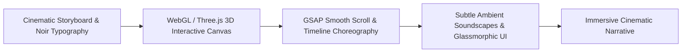

# 🎬 Cinematic-X Skill & Visual Experience Framework

> A design system and interactive skill specification for crafting high-fidelity, story-driven cinematic web experiences, WebGL 3D viewports, and immersive visual portfolios.

---

## 📌 Conceptual Framework

---

## 🌟 Core Tenets

- **Visual Storytelling:** Transitioning web portfolios from static grids into continuous cinematic sequences.
- **Lighting & Atmosphere:** Utilizing depth-of-field, volumetric lighting, and subtle camera motion blur.
- **Performance Optimization:** 60fps GPU-accelerated transforms, deferred rendering, and progressive asset loading.

---

## 👤 Author

**Seelaboyina Deekshith**
- GitHub: [@Deekshith06](https://github.com/Deekshith06)
- Repository: [Cinematic-X-Skill](https://github.com/Deekshith06/Cinematic-X-Skill)
